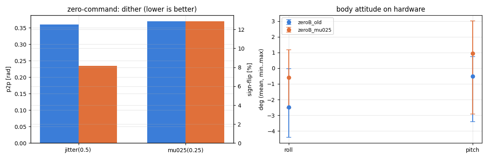
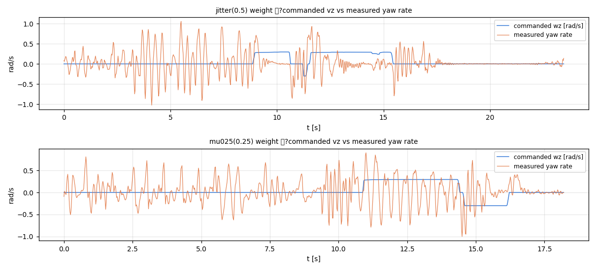
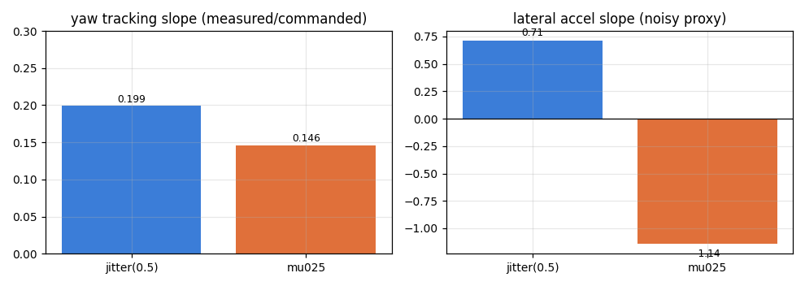
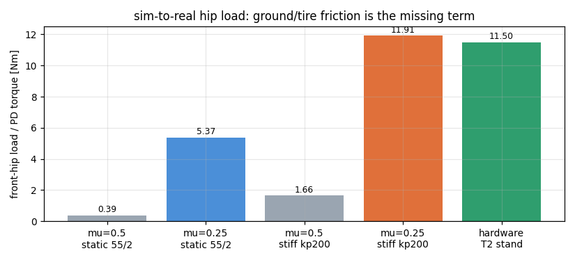
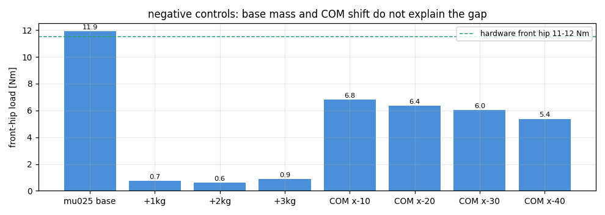
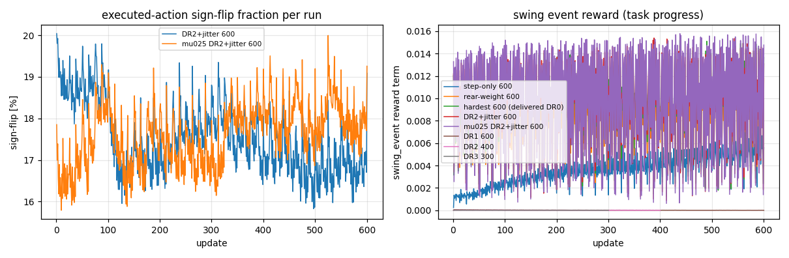
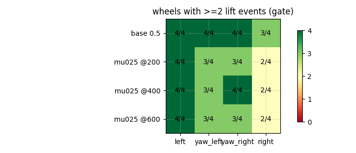
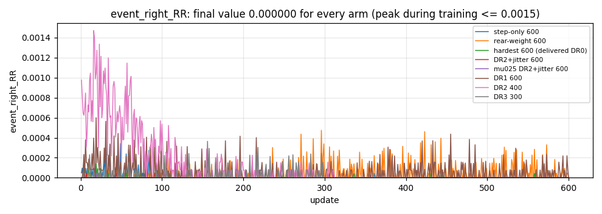

# 2026-11-20 · AS2-W v2 平地踏步线：从仿真到实机的一整天

本目录是一次完整会话的归档：训练配方与实验、仿真—实机对照、部署尝试、实机日志分析、以及一个否定的结论。
所有数字都来自本会话实际跑出的日志（训练服务器 Isaac Lab / PhysX、CPRO 实机、本地分析脚本），
原始大文件（4.8 GB 实机日志、权重、回放带）不在仓库里，见 `manifest.md`。

## 一句话结论

- **vx 移出任务 + tanh 化 + 抖动随机化** 让实机零命令抖动显著下降（符号翻转率 30% → 8–13%），但 **侧移与转向在实机上仍基本不动**。
- 找到并量化了仿真缺失项：**轮地摩擦**（训练用 μ=0.5，实机约 0.25；静态髋负载 0.39 → 5.37 Nm，刚性保持口径 1.66 → 11.91 Nm，实机 11–12 Nm）。
- 但**把摩擦对齐后重训的权重上机实测，转向没有改善（斜率 0.146 vs 旧权重 0.199）**——摩擦假设不足以解释转向弱。这是一个必须记住的否定结果。

## 关键图表

| 图 | 说明 |
|---|---|
|  | 实机零命令：两版权重的目标抖动（p2p、翻转率）与机身姿态 |
|  | 实机摇杆：指令 wz 与实测偏航率的时间序列（两版权重） |
|  | 转向/侧移回归斜率对比（旧权重 0.199 vs mu025 0.146） |
|  | **核心证据**：髋负载随摩擦变化，μ=0.25 刚性保持 11.91 Nm ≈ 实机 11–12 Nm |
|  | 反证：底盘质量、质心偏移都不解释差距 |
|  | 八条训练臂的抖动指标与步态进度曲线 |
|  | 摩擦对齐前后各检查点的门禁矩阵（四方向 × 检查点） |
|  | 全部训练臂的 `event_right_RR` 轨迹：训练中峰值 ≤0.0015（约每 700 帧一次），**收敛后最终值为 0.000000** |

## 训练实验汇总（8 条臂，脚本与配置见 `v2-step/`）

| 臂 | 轮数 | 右后轮事件 | 右后轮承重 | swing_event | 说明 |
|---|---|---|---|---|---|
| step-only 600 | 600 | 0.000 | 0.969 | 0.0056 | 首次移除 vx |
| 后轮加权 600 | 600 | 0.000 | 0.903 | 0.0118 | 后轮覆盖 ×3 |
| 最重轮 600（DR0 交付） | 600 | 0.000 | 0.953 | 0.0137 | 三方向 4/4 |
| DR2+抖动 600 | 600 | 0.000 | 0.933 | 0.0131 | 抖动随机化，实机翻转率 8.2% |
| mu025 DR2+抖动 600 | 600 | 0.000 | 0.946 | 0.0148 | 摩擦对齐，实机转向反而更弱 |
| DR1 600 | 600 | 0.000 | 0.800 | 0.0000 | vx 保持 |
| DR2 400 | 400 | 0.000 | 0.877 | 0.0000 | |
| DR3 300 | 300 | 0.000 | 0.875 | 0.0000 | 加推力扰动 |

**右后轮事件在全部 8 条臂的最终轮次都是 0.000000**（训练过程中偶发，峰值 ≤0.0015，约每 700 帧一次，收敛后消失）——这条曲线比任何文字都更能说明 right 方向的几何约束。

## 文档索引

| 文件 | 内容 |
|---|---|
| `docs/friction-unmodeled-20261120.md` | **本轮最重要**：摩擦缺失项的量化、反证、mu025 重训结果 |
| `docs/jitter-compare-20261120.md` | 抖动随机化权重 vs DR0 权重（干净/扰动双条件） |
| `docs/field-zero-b-jit-20261120.md` | 实机首飞：零命令 10 s 的抖动与姿态对比（30%→8.2%） |
| `docs/cpro-deploy-20261120.md` | CPRO 部署过程：模型同步、ARM64 构建、CTest、只读回放、C++↔Python parity |
| `docs/step-hard-600.md` / `tanh-baseline.md` / `dr1-300.md` / `dr2-400.md` / `dr3-300.md` | 之前的阶段报告（动作参数化、DR 分级） |
| `docs/stop-ab.md` | 停车奖励 A/B |
| `docs/AS2W-training-journal.md` | 全局训练日志（约 70 节，含本轮所有阶段的原始记录） |
| `analysis/*.json` | 各种量化结果（门禁、对照、实机指标、力矩） |
| `data/*.csv` | 降采样后的可复算数据（实机时间序列 10 Hz、训练曲线、门禁矩阵） |
| `plans/` | 下一步计划与曲线监控清单 |
| `tools/` | **本次会话实际用到的分析代码**（实机日志、仿真力矩、ONNX 对拍、资产变体、评测驱动、出图），含"结论 → 脚本"溯源表 |

## 实机过程摘要

| 时间 | 事件 | 关键数字 |
|---|---|---|
| 18:49 | CPRO 连接（192.168.10.75），只读基线 | 保护流 `motorstate_or=0x0`，16 轴 mode1，电池 48.2 V |
| 18:50 | 零命令 B 接管（抖动权重） | 501 帧/10 s，翻转率 **8.2%**（旧权重 30%），pitch −0.51°，零告警 |
| 18:57 | 有界摇杆轮（抖动权重，vy 0.10 / wz 0.10） | yaw 跟踪 **0.079**，vy 有效帧仅 7.6% |
| 19:01 | 摇杆轮抬到上限（vy 0.20 / wz 0.30） | yaw 跟踪 **0.164**（0.26 rad/s 指令 → 0.049 实测） |
| 20:04 | mu025 权重重上机：零命令 | 翻转率 12.85%，**roll 左倾消除（−2.49°→−0.58°）** |
| 20:10 | mu025 权重摇杆轮 | **yaw 斜率 0.146 < 旧 0.199** → 摩擦假设被实机否定 |

## 数值要点（可复算）

- 门禁：left / yaw_left / yaw_right 在旧权重下 4/4；right 从 3/4（μ=0.5）到 2/4（mu025 重训）；**RR 轮在任何版本、任何摩擦下都未抬起**（几何约束，15 个训练臂 + 15 mm 配重均无效）。
- 训练内抖动指标：`executed_signflip_fraction` 0.200 → 0.166（DR2+抖动 586 轮）。
- 仿真静态髋负载：μ=0.5 → 0.39 Nm；μ=0.25 → 5.37 Nm；刚性保持（kp=200，实机姿态）→ 1.66 / **11.91** Nm；实机 T2 站 11–12 Nm。
- 实机零命令 PD 力矩（髋）：旧权重 6.19/3.98/4.18/5.91 Nm；mu025 权重 5.32/4.90/4.38/3.92 Nm。

## 复现入口

- 训练：`v2-step/scripts/run_tanh.sh --step-only --dr-level 2 --reward-config reward_config_hard.json`（配 `ASSET=…/as2w-t2-v2-mu025.usd` 即摩擦对齐版）
- 评估：`eval_out.sh`（干净）/ `eval_dr.sh <ckpt> <dir> 2`（DR2，需 `AS2W_CAPTURE_TAPE=1` 落回放带）
- 实机：`deploy/robots/as2w/unitree58/` 的 `as2w_unitree58_lp5_publish`（零命令）与 `as2w_unitree58_lp5_joy_publish`（摇杆），运行器在 `tools/run_unitree58_v2step_*.sh`
- 分析：本目录 `make_plots.py` 与 `AS2W-v2-stage-reports/` 下的分析脚本
