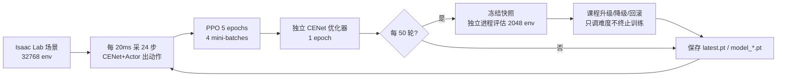

# AS2-W 双足滑行（双轮平衡滑行）训练方法归纳

> 只读勘察报告 · 数据来源：同事训练服务器（主机名 `chenzihao-MS-7E17`，Ubuntu 24.04，2×RTX 5090）
> 勘察时间：2026-11-16（Asia/Shanghai）
> 勘察方式：SSH 只读（`ls/cat/base64`、下载副本到本地阅读），**未在服务器上创建、修改、删除任何文件，未启动/停止任何进程**。
> 文本中所有以 `/home/chenzihao/...` 开头的路径均为服务器上的原始位置；本地副本仅用于阅读。

---

## 0. 一句话结论

这台服务器上的“双足滑行”不是迈腿走路，而是 **As2-W 四轮足机器人把两条前腿收起来、仅靠两个后轮着地，保持车身直立并完成前进/后退/原地转向的轮式平衡滑行**。训练是 **Isaac Lab/PhysX 大规模并行仿真（32768 环境）+ CENet 状态估计 + PPO 策略 + 分课程自动升降难度** 的强化学习流水线，同一套代码里先后迭代了三代：**残差策略（v3 默认）→ 独立九课程 → 在线课程**，另外还有一条 **GPU0 直接动作策略 + 课程奖励大修** 的后续试验线。目前公开记录里，**站立/前进/后退已能稳定滑行，转向仍在收敛中**（详见第 8 节）。

---

## 1. 术语与任务定义

| 术语 | 在本项目中的含义 |
|---|---|
| **双足滑行 / glide** | 前轮离地、后轮着地的两轮平衡行驶（wheeled bipedal balance & gliding），**不是双足交替迈步** |
| **滑行** | 后轮滚动前进/后退/转向；车身像倒立摆一样由后轮前后微动维持直立 |
| **双足站立** | 零指令下仅后轮支撑、车身静止直立（滑行的前置技能） |
| **前后错位 / stagger** | 两后轮沿机身前后方向的相对位置差；目标为 0，超限终止回合（v3 起改为软约束可关） |
| **轮距 / width** | 两后轮横向间距，标定值 `0.4418 m` |
| **课程 course** | 按方向/速度档拆分的训练任务（站立、前进、后退、前进停车、后退停车、左转、右转、左转停车、右转停车） |
| **CENet** | 本项目自研的“历史编码 + 本体速度估计 + 32 维隐变量”状态估计网络，给 Actor 提供估计速度与上下文 |

关键物理前提（来自 `config/biped_reference.json`，由真机录包标定）：

- 前腿收拢：`FR/FL_thigh ≈ 2.63 rad`、`calf ≈ -2.07 rad`；后腿承重：`RR/RL_thigh ≈ 2.4 rad`、`calf ≈ -1.5 rad`。
- 前轮离地高度 `front_wheel_clearance ≈ 0.35 m`（训练终止门槛也取 0.35 m）。
- 参考车身姿态：`root z ≈ 0.6125 m`；轮半径 `0.086 m`；整机质量 `26 kg`。
- 官方 URDF SHA256 `05da6240…7d2c`；**实测姿态**与**承重 PD 目标**分开保存，不能用实测姿态当 PD 零位。

---

## 2. 代码在哪里（只读地图）

服务器上相关目录共三处，**互不覆盖**：

| 位置 | 作用 | 关键文件 |
|---|---|---|
| `/home/chenzihao/projects/as2w-sim`（主项目，含 `.git`） | 双足滑行主训练代码、配置、历史日志 | `scripts/biped_glide.py`、`scripts/biped_glide_v3.py`、`src/as2w_sim/glide_*.py`、`config/biped_glide*.json`、`docs/biped_*.md/json` |
| `/home/chenzihao/projects/192.168.10.35-GPU0-AS2W-CourseReward-WheelAlign-from7800-20261115` | GPU0 后续试验线（7800→15000）：**直接动作策略 + 60 项课程奖励大修** | `task_config.formal.json`、`source_snapshot/`、`formal/`、`reward_term_audit.json`、`change_record.txt` |
| `/home/chenzihao/as2w-test-zbg-1113/AS2-W_CPRO` | 从我们工作站镜像过去的部署项目副本（与训练无直接关系） | `部署参考/`、`部署测试/` |

`as2w-sim` 顶层还有两条**不同用途**的线，别混淆：

- **双足线（本文主题）**：`glide_*` / `biped_*` / `stand_turn_*`。
- **起身线（另一条）**：`rise_*`，训练的是“四足趴 → 双足站起”，设备约定写在 `as2w-sim/AGENTS.md`，与滑行线独立。

---

## 3. 物理与控制约定（两代一致的“硬合同”）

| 项目 | 数值/做法 | 出处 |
|---|---|---|
| 机器人 | Unitree As2-W，**16 轴** = 12 腿关节 + 4 轮；自由基座（不锁根、不加外力托举） | `config/robot.json`、`biped_env.py` |
| 物理步长 | **5 ms**（200 Hz） | `control.physics_dt_s` |
| 策略频率 | `decimation=4` → **20 ms / 50 Hz** | 同上 |
| 腿 PD | `Kp=25`、`Kd=0.8`，每个物理子步重算显式 PD 力矩 | `control.leg_kp/kd` |
| 后轮 | **速度控制**：`Kp=0`、`Kd=0.5`；轮目标限幅 `±40 rad/s` | `control.wheel_kp/kd` |
| 前轮 | 动作恒为零（训练、观测、导出统一屏蔽），只保留被动滚动 | `clip_glide_actions` |
| 力矩限幅 | 髋/大腿/膝/轮 URDF 60/60/90/15 Nm，按 **95% 包络**裁剪 + 超速反向卸力 | `pd_effort`、GPU0 `effort_limit_fraction=0.95` |
| 轮几何 | 半径 0.086 m，轮距 0.4417605115 m（由参考文件强校验） | `model.wheel_spacing_m` |
| 回合长度 | 20 s | `episode_s` |
| 终止条件 | 倾角 > **18°**；高度越界（0.53–0.67 m）；任何非后轮接触力 > **2 N**；丢后轮支撑 > 0.1 s；位移 > 200 m；v3 另加前后错位/轮距/姿态/航向漂移越限 | `termination` |
| 重置随机化 | 倾角 ±0.5°、关节噪声 0.0025 rad、水平初速 0.01 m/s、航向全随机；**训练开观测噪声，评估关** | `reset` |
| 动作接口 | 16 维：前 12 腿角残差 + 4 轮速；前轮 12/13 恒 0 | `clip_glide_actions` |

**动作到电机的映射**（v3 残差版，`glide_task.glide_motor_targets`）：

```
leg_target  = clamp(pd_target_reference + leg_action_scale * action, lower-0.15, upper+0.15)
wheel_target= 40 rad/s * action[12:16]        # 前两维被置 0
torque      = Kp*(leg_target-q) - Kd*dq       # 腿
              Kd*(wheel_target-dq)            # 轮
```

- 腿动作尺度（v3）：前腿髋/大腿/小腿各 `0.035 rad`；后腿髋/大腿/小腿 `0.05/0.08/0.10 rad`；后腿动作可到 ±3（残差范围约 ±0.15/0.24/0.30 rad）。
- GPU0 直接策略版把腿动作尺度放大为 `0.12/0.2/0.2`（前）与 `0.18/0.35/0.45`（后），腿动作 ±1，PD 目标不再留 0.15 rad 外裕量（`pd_target_limit_margin_rad=0.0`，改由力矩包络限幅）。

---

## 4. 网络与观测

### 4.1 观测 / 历史 / Critic

| 观测 | 维度 | 内容 |
|---|---|---|
| `policy` | **56**（GPU0 版 53） | 机身角速度×0.25 `[0:3]`；重力投影 `[3:6]`；**指令 vx/wz + 参考路径/航向** `[6:9]`；实测腿角相对参考的误差 `[9:21]`；关节速度×0.1 `[21:37]`；上一步动作 `[37:53]`；**编码器路径误差、相对航向误差、保持标志** `[53:56]`（GPU0 版为 53 维，无最后三项） |
| `history` | **560**（=56×10；GPU0 530） | 最近 10 帧 policy，**旧帧的指令/参考槽位被清零**（`HISTORY_MASK = 6,7,8,53,54,55`），旧到新排列 |
| `critic` | **72**（GPU0 83） | policy + 真实本体速度（特权）+ 2×高度 + 12 路接触力/100；仅训练用，部署不需要 |

### 4.2 网络结构

```
history(560) ──► CENet encoder: 560→128→64 ──► velocity(3) / latent_mean(32) / latent_logvar(32)
                                                   │
policy(56) ───────────────────────────────────────┴──► Actor MLP 91→512→256→128→16 (ELU)
critic(72) ───────────────────────────────────────────► Critic MLP 72→512→256→128→1
```

- **CENet 损失** = 速度估计 MSE + 物理观测量重建 MSE + `1e-3 ×` KL；VAE 采样只用于重建损失，推断路径是确定性的（同一历史给同一上下文）。
- **v3 Actor 不是纯 MLP，而是“固定线性平衡反馈 + 有界学习残差”**（`GlideResidualActor`）：
  - 基座矩阵来自 `config/standing_position_initialization.json` 的降阶 LQR 平衡模型（`K` 增益 + 偏航前馈），初始化时冻结、训练中不变；
  - 学习残差 `tanh(MLP) × 0.03`，后轮残差只在**有转向指令**时保留差速，直行时只保留共模；
  - 转向时对腿残差做投影，避免左右腿反向动作破坏转向几何（`learned_leg_differential_fraction=0.1`）。
- **GPU0 后续版改成直接动作策略**（`StandTurnActorCritic`）：无 LQR 基座、无残差头，16 维动作由单个高斯 MLP 直接输出，CENet 只估状态不产生电机修正。

### 4.3 探索噪声（PPO 的高斯标准差）

- v3：初始 `0.1`；后轮初始 `0.02`，物理上限 **0.8 rad/s**；腿噪声以 17250 轮已验证标准差为上限（逐关节 0.005–0.039 rad）。
- 在线课程版（`as2w-action-exploration-v2`）：腿熵奖励置 0、前轮熵 0、后轮熵 ×0.2；**每个课程等级有自己的噪声缩放**（站立 0.5、前进 0.25→0.7、转向 0.15→1.0 等），采样时记录缩放量，PPO 似然/熵/KL 按原始上下文重算。

---

## 5. 奖励设计

### 5.1 计分方式

每个奖励项按 `weight × value × dt(0.02)` 累加；**站立档与运动档是两套权重**，用课程的 `reward_blend` 线性插值（S0=0，S1=0.25，S2=0.65，S3+=1.0），有指令保持段时强制回站立档；终止额外 `-10`（GPU0 为 `-5`）。

### 5.2 奖励主线（v3 / online 两版一致的核心）

| 类别 | 代表项 | 权重（站/动） | 说明 |
|---|---|---|---|
| 速度跟踪 | `tracking_forward`、`tracking_yaw` | +1.0/+1.5 | 指数核，σ 随指令幅值缩放（0.03–0.15 m/s、0.05–0.2 rad/s）；零指令时用 0.02 m/s 死区 |
| 姿态 | `flat_orientation` | −10/−3 | 重力投影水平分量平方，**站立严、运动松** |
| 高度 | `height_error` | −500/−100 | 相对参考 0.6125 m 的平方误差 |
| 姿态参考 | `pose_tracking` | +1.0/+0.5 | 12 腿角相对 PD 参考的高斯核，站立 σ 小、运动 σ 大 |
| 后轮支撑 | `rear_support` | +0.5 | 12 路接触中后两轮全部 >5 N 的比例 |
| 腿姿态 | `leg_posture` | −5/−1 | 腿角误差平方均值 |
| 平衡辅助 | `lateral_velocity`、`vertical_velocity`、`roll_pitch_rate` | −1 / −1 / −0.05 | 抑制侧移、跳起、滚转俯仰角速度 |
| 对称 | `rear_symmetry` | −1/−0.2 | 后腿相对实测姿态镜像偏差；有转向指令时权重降到 −0.2 |
| 几何 | `stance_stagger`、`stance_width` | −1 / −0.5 | 前后错位、轮距偏差（15 mm 死区 + 20/25 mm 尺度） |
| 站立位置 | `standing_position` | −1 | 停车保持期内相对停车点的漂移（5 mm 死区 / 30 mm 尺度） |
| 航向漂移 | `heading_drift` | −0.5 | 相对参考航向（0.25° 死区 / 2° 尺度） |
| 电机成本 | `normalized_effort`、`normalized_power`、`leg_velocity`、`leg_acceleration`、`joint_velocity_limit` | −0.02 / −0.02 / −0.02 / −2e-4 / −0.2 | 都按各关节 URDF 限幅/限速归一化 |
| 动作平滑 | `leg_action_rate`、`rear_wheel_target_rate` | −0.03 | 一阶差分平方（轮目标按 8 rad/s 归一化） |
| 力矩饱和 | `torque_saturation_gap` | −0.1 | PD 原始力矩与裁剪后差值/限幅的平方 |
| 接触滑移 | `longitudinal_contact_slip`、`lateral_contact_slip` | −0.05 / −0.1 | 接地点切向速度沿机身纵/横向分别计 |
| 其它 | `alive`、`termination`、`raw_action_overflow`、`joint_limit` | +0.1 / −10 / −1 / −2 | 存活、终止惩罚、动作越界、关节限位 |

> 完整权重表（含 online 新增的 `turn_leg_posture`、`turn_axle_drift` 与 GPU0 新增 22 项）见附录 A。

### 5.3 GPU0 后续线的奖励大修（2026-11-15，`change_record.txt`）

在 **60 项**奖励上做了“课程 + 真实轮向”修订，重点变化：

1. **真实轮向** `wheel_heading`：每个轮相对机身水平前方的滚动线角度，目标 0°；由“1° 死区/3° 尺度/权重 −1.25”改为 **零死区 / 5° Huber / 权重 −25/12（表中 −1.5）**，两轮各自计成本后取平均与最差侧各半。
2. **零指令角速度** `standing_yaw_instant/ema_tail`：当前与目标指令都严格为零时生效，瞬时 + 2 s EMA 各 −0.2。
3. **零指令累计航向** `standing_position_tail`：新增 −0.03 × Huber(ψ; 3°, 10°)，弱尾项不封顶。
4. **低速转向** `turn_yaw_error`：在 −2.0 原项后附加 −0.15 × gate × Huber(ω−u; 0.002, max(0.01, 0.2|u|))，gate 在 |u|≤0.15 rad/s 为 1、0.15–0.30 线性退出。
5. **高度**：改为 **±0.02 m 带外平方**，系数仍 −100（不再全区间平方）。
6. **两轮前后差**：保留 −1 × Huber(Δx; 5 mm, 20 mm)，目标为实际两轮中心 Δx=0。
7. **横向速度**：纯转向及其保持段改用**后轮轴心速度**，避免把车身绕轴心转动误当轴心平移。
8. **力矩/功率/饱和差**：与实际 95% URDF 力矩包络对齐，PD/限矩/限速/限位物理未改。

该线的 60 项逐项归档在 `reward_term_audit.json`：**11 项有效率/归一化有改动，其余 48 个非终止项与终止事件保持**。审计结论明确写着“配置里的旧占位权重不等于最终有效率，要看实际最后覆盖层”。

---

## 6. 课程系统（三套机制并存）

### 6.1 静态分级课程 `GlideCurriculum`（基础版）

- 14 个 stage（`standing → start_stop_0.1/0.2/0.3 → straight_0.5/0.8 → turn_0.3/0.5/0.8 → fast_1/1.2/1.5 → optional_1.75/2.0`），`last_required_level=11`，1.75/2.0 m/s 默认锁定。
- 每 50 次 PPO 更新做一次**独立评估**（每组至少 64 个 20 s 回合），按 `evaluation_cells` 覆盖所有速度档/转向档 × 是否扰动初态。
- 晋级/降级：S0 站立连续 2 轮 ≥90% 才放低速滑行；S1 入口 ≥80%、其后 ≥90%，且物理生存率 ≥99%；最终档需连续 3 轮 ≥98%，再做三接触模型 + 120 s 站立/60 s 运动长回放。
- **课程永远不会结束训练**：评估缺失、跨接触验证异常只记录并留级；最终认证完成后仍训练到预算轮数。降级冷却 100 次更新；硬失败率 ≥5% 立即降档。

### 6.2 独立九课程 `IndependentGlideCurriculum`（2026-11-09 起）

把“共享一个难度等级”改成**每条课程各自有等级/通过计数/冷却/证据**：

| 课程 | 权重（v3 / online） | 源等级 |
|---|---|---|
| `standing` | 0.20 / 0.20 | S0 |
| `forward` | 0.25 / 0.20 | 1,2,3,4,5,9,10,11 |
| `backward` | 0.25 / 0.20 | 1,2,3,5,11 |
| `forward_stop` | 0.15 / 0.10 | 1,2,3,4,5,9,10,11 |
| `backward_stop` | 0.15 / 0.10 | 1,2,3,5,11 |
| `turn_left` / `turn_right` | 0 / 0.05，0 / 0.05 | 6–11 |
| `turn_left_stop` / `turn_right_stop` | 0 / 0.05，0 / 0.05 | 6–9 |

- **一个物理回合固定一条课程 + 一个方向**；停车课程交替“运动段 → 停车保持段”。
- 某项失败只降本项，不回滚共享网络，不改变其他项等级。
- 每档至少训练 100 次更新；晋级 0.9（S1 入口 0.8）、连续 2 轮；降级连续 2 轮低于 0.7；硬失败率 ≥5% 立即降档并冷却 100 次更新。
- **前后方向切换有互锁**：先减速到编码器速度 ≤0.03 m/s、转速 ≤0.05 rad/s 并持续 1 s，才允许反向指令（`ReversalInterlock`）。

### 6.3 在线课程 `OnlineGlideCurriculum`（2026-11-09 晚，v3 当前用法）

- **每次 PPO 更新后**用新完成回合的独立窗口判断难度，不再等 50 轮评估；`minimum_episodes=256`、`minimum_frontier_episodes=64`、`frontier_fraction=0.8`、`minimum_steady_s=5`。
- 评估证据不足时**回滚课程状态并留级**，训练继续（`online_evidence_unavailable`），不会因课程证据异常停训。
- 冻结检查点由**独立进程、独立仿真环境**在 GPU0 评估（2048 环境），GPU1 训练不重置在途回合；评估结果跨代失效（generation 变化即判 stale）。
- 每 50 轮才触发一次后台评估，避免评估与训练抢显存/CPU。

### 6.4 GPU0 后续线的“固定比例课程”

2026-11-15 的 GPU0 线把课程简化为 **站立 20% / 平移 40% / 转向 40%**，非零命令按幅值 `0–0.15 / 0.15–0.30 / 0.30–0.50` 连续采样，基础比例 **40/30/30**；前 100 次更新只做一次从 30/30/40 到 40/30/30 的过渡；每 10 s 换命令、保留 0.5 m/s² / 0.5 rad/s² 斜坡；运动课程每第 4 个命令段安排一次零命令保持。**课程评分只记录、不调难度**（`report_only_fixed_sampling`），这与前两套“评估驱动升降级”是本质区别。

---

## 7. 训练与评估流水线

### 7.1 主循环



### 7.2 PPO 超参（v3 配置）

| 参数 | 值 | 参数 | 值 |
|---|---|---|---|
| rollout | 24 步/env | learning rate | 1e-4，自适应到 1e-5（KL=0.01） |
| epochs | 5 | mini-batches | 4 |
| γ / λ | 0.9801 / 0.9025 | clip | 0.2 |
| entropy | 0.005 | value loss | 1.0，clip |
| CENet 优化器 | Adam 3e-4，1 epoch，KL 权重 1e-3 | max grad norm | 1.0 |
| 预算 | v3 17500；online 20000 | 环境数 | 32768（4096×8） |

GPU0 后续线改为：2 epochs、固定 LR `1e-5`、γ=0.995、λ=0.95、entropy 0.001、**CENet 冻结（0 epoch）**、预算 7800→15000。

### 7.3 评估门槛（摘要）

固定评估集按课程生成：站立；前进/后退各速度档（0.1–2.0 m/s）及各自停车；左/右转各角速度档（0.3/0.5/0.8/1.0）及停车；转向档 >0.3 时再加曲线组合；**每格 ×2（名义初态 / 扰动初态）**。

最终精度门槛（`acceptance`，节选）：生存率 ≥95%、后轮支撑 ≥99%、倾角 p95 ≤5°、姿态 RMSE ≤0.12 rad、速度 MAE ≤0.035 m/s、转向 MAE ≤0.05 rad/s、站立漂移 ≤0.12 m、前后错位/轮距 ≤0.03 m、高度 RMSE ≤0.025 m、航向漂移 ≤1°、停车位置 RMS ≤8 mm/峰值 15 mm、指令运动比 ≥0.8。

### 7.4 检查点与契约

- 检查点保存：模型 + **两套 Adam 优化器**（PPO、CENet）+ 学习率 + 课程状态 + 两个优化器的 RNG 状态 + `total_updates`。
- 加载时**逐项校验训练契约**（任务/物理/参考姿态/实现 SHA），不匹配直接拒绝。
- 导出 `policy_observable_only.pt`（TorchScript）与 `policy.onnx`，导出前后做数值一致性断言（ONNX 误差 ≤2e-5）。
- 部署只需要 `policy` + `history` 两路观测，不需要 critic。

---

## 8. 实际训练记录与结果（截至 2026-11-16）

### 8.1 时间线

| 日期 | 事件 | 结果 |
|---|---|---|
| 2026-11-06 | v1 双足初版 | 训练/执行链路通过；短测权重约 1.4 s 因倾斜终止，**未通过站立验收** |
| 2026-11-07 | v2 双足平衡滑行（5 ms、残差、3 阶段课程） | 15 项测试通过；短测权重约 1.06–1.24 s 终止，**未通过平衡/滑行验收** |
| 2026-11-07 | v3 滑行基线（新奖励/九课程） | 32768 环境正式训练；曾因旧课程第 50 轮提前退出，11-08 移除退出路径 |
| 2026-11-09 | 独立九课程 + 在线课程 v1/v2/v3 | 前进/后退稳定；转向仍因 heading drift 终止 |
| 2026-11-10 | `biped_stand_turn_scratch_v1`（直接动作策略，5000 轮） | **失败**：站立 basic 14%、转向生存率 0%，全部轴未通过 |
| 2026-11-15 | GPU0 critic118 课程奖励大修（7800→15000） | 训练完成 15000；**未通过能力验证** |
| 2026-11-16 | 用户决定“暂时废弃”原 7800 基线 | `active_baseline=null`；15000 未升为替代基线 |

### 8.2 17250 轮检查点复演（`biped_online_v3_from17250_validation_20261109.json`）

每组 16 回合、20 s：

| 场景 | 生存 | basic 通过 | 严格通过 | 备注 |
|---|---|---|---|---|
| 站立（mean） | 16/16 | 16/16 | **15/16** | 基本达标 |
| 前进 | 16/16 | 16/16 | **16/16** | 速度跟踪达标 |
| 后退 | 16/16 | 16/16 | **16/16** | 已能稳定后退 |
| 前进停车 | 16/16 | 16/16 | 0/16 | 停车保持精度未过 |
| 后退停车 | 16/16 | 0/16 | 0/16 | 速度误差 p95 超标 |
| 左/右转 | **0/16** | 0/16 | 0/16 | 平均 4.44 s 因 **heading drift** 终止 |
| 转向停车 | 0/16 | 0/16 | 0/16 | 同上 |

文档明确保留的三条局限：**转向仍因 heading drift 终止且质量不达标；后退停车未认证；短时验证不代表长期收敛**。

### 8.3 GPU0 后续线（2026-11-15）

- 源 7800（SHA `9ae5b4b5…7a50`）→ 目标 15000，32768 环境、`cuda:0`（物理 GPU0 UUID `GPU-f13de855…fd204`），单进程追加 7200 轮，每 100 轮保存（`model_9999.pt` 等，共 144 个检查点），实际跑到 15000 后正常退出。
- 首更新回执：`first_actual_update=7801`，`ppo_epochs=2`、`cenet_frozen=true`、`family_counts={standing:6554, translation:13107, turning:13107}`、`course_quality_role=report_only_fixed_sampling`、`raw_policy_no_postprocessing=true`。
- 训练完成时 `progress.json`：`status=completed_requested_updates`，三条轴 `index=0`、`certified_through=-1`、`qualified=false`（在线评分只记录、未晋级）。
- **关键边界**：该线 7800 基线于 2026-11-16 被用户“暂时废弃”，15000 **未通过能力验证、未升为基线**；当前 `active_baseline=null`，模型与日志保留。
- 11-16 20:04 另有一条 **13 服务器 GPU0 BudgetV2 速度预测版**训练（`192.168.10.13`，与 10.35 无关）被停止，最后 `model_900.pt`。

> 结论：**“站立 + 前进 + 后退”在 17250 轮已有可复现的稳定滑行证据；“转向”和“停车保持”仍未收敛，是当前主要瓶颈。**

---

## 9. 已知问题与边界（读这份文档时别踩的坑）

1. **转向是最难的一项**：转弯需要左右后轮差速 + 车身反扭，当前策略常在 4.4 s 左右触发航向漂移终止；GPU0 线新增 `wheel_heading`（−25/12）和 `turn_yaw_error` 等项就是针对这个。
2. **前后错位/轮距是几何硬约束**：v3 早期直接终止，后改为软约束（6 cm 内二次惩罚、监测与 3 cm 完成率继续记录）；GPU0 改为 `stance_width=-2.0` 加重、错位仍 −1。
3. **前轮接触是硬失败**：任何前轮着地 >2 N 立即终止；这也是“双足”成立的前提。
4. **CENet 与 PPO 是两个优化器**：CENet 的 KL/熵/似然必须用采样时上下文重算，否则 PPO 比率会偏；v3 专门为此保留了按课程等级的噪声缩放记录。
5. **课程评估与训练抢资源**：评估必须独立进程 + 独立 GPU，且一次只跑一个后台评估，避免重叠仿真器。
6. **没有真机部署证据**：所有 `scope` 字段都写的是 `simulation_only_no_hardware_control`；本文只覆盖仿真训练，不能据此说已上狗。
7. **版本很碎**：`biped_glide_v3.json`（37 项奖励、残差策略）、`biped_glide_turn_online_v3.json`（39 项、在线九课程）、GPU0 `task_config.formal.json`（60 项、直接策略）**互不兼容**，检查点不能混用；换配置等于新版本。

---

## 10. 复现入口（只读参考，未在服务器执行）

```bash
cd /home/chenzihao/projects/as2w-sim

# 契约测试（CPU，不需要 Isaac 渲染）
.venv-isaac/bin/python -m unittest discover -s tests -p test_biped.py -v

# 有界烟测（64 环境，2 次更新，丢弃权重）
PYTHONPATH=src OMP_NUM_THREADS=4 .venv-isaac/bin/python scripts/biped_glide.py \
  --mode smoke --num-envs 64 --iterations 2 --device cuda:1 --headless \
  --output outputs/glide_v3_smoke

# 正式训练（online 九课程，32768 环境）
PYTHONPATH=src OMP_NUM_THREADS=4 .venv-isaac/bin/python scripts/biped_glide.py \
  --mode train --num-envs 32768 --iterations 20000 --device cuda:1 --headless \
  --task-config config/biped_glide_turn_online_v3.json --output logs/glide_online_v3

# 独立评估（至少 20 s，需 checkpoint）
PYTHONPATH=src OMP_NUM_THREADS=4 .venv-isaac/bin/python scripts/biped_glide.py \
  --mode evaluate --num-envs 64 --checkpoint logs/glide_online_v3/latest.pt \
  --evaluation-seconds 20 --task-config config/biped_glide_turn_online_v3.json \
  --output outputs/glide_eval
```

GPU0 直接策略线的入口是 `scripts/biped_stand_turn.py --mode resume --checkpoint ... --task-config task_config.formal.json`（详见该 run 的 `launch.json`）。

---

## 11. 需要向同事确认的 7 个问题

1. **“双足滑行”是否特指 `biped_glide*`（双轮平衡滑行）**，还是也包括 `rise_*`（四足起身到双足站立）？
2. 当前是否还有**在跑的双足训练**？从进程看 GPU0 被 `as2w-sim-tron2-mask8-postprocess` 占用（mask10 后处理，163707 启动、32768 环境），与滑行线无关。
3. `as2w-sim` 工作区里未提交的 `config/biped_*.json` 与 `src/as2w_sim/cenet_ppo.py` 改动，是否就是当前生效版本？
4. GPU0 线 15000 的 checkpoint 是否还打算做能力评估，还是彻底弃用？
5. 转向的下一步方向：继续调奖励（`wheel_heading`/`turn_yaw_error`）、换课程采样，还是加航向外环？
6. 是否需要把 **MuJoCo 原生闭环**（`as2w_sim.glide_native`）的验收结果也纳入基线？
7. 真机部署是否已有计划？目前所有配置都标注仅仿真。

---

## 附录 A：奖励权重全表

| 奖励项 | v3 站 | v3 动 | online 站 | online 动 | GPU0 站 | GPU0 动 |
|---|---|---|---|---|---|---|
| `tracking_forward` | 1.0 | 1.5 | 1.0 | 1.5 | 1.0 | 1.0 |
| `tracking_yaw` | 1.0 | 1.5 | 1.0 | 1.5 | 3.0 | 3.0 |
| `flat_orientation` | -10.0 | -3.0 | -10.0 | -3.0 | -12.0 | -12.0 |
| `alive` | 0.1 | 0.1 | 0.1 | 0.1 | 1.0 | 1.0 |
| `rear_support` | 0.5 | 0.5 | 0.5 | 0.5 | 0.5 | 0.5 |
| `front_clearance` | 0.0 | 0.0 | 0.0 | 0.0 | 0.0 | 0.0 |
| `lateral_velocity` | -1.0 | -1.0 | -1.0 | -1.0 | -1.0 | -1.0 |
| `vertical_velocity` | -1.0 | -1.0 | -1.0 | -1.0 | -0.5 | -0.5 |
| `roll_pitch_rate` | -0.05 | -0.05 | -0.05 | -0.05 | -0.1 | -0.1 |
| `height_error` | -500.0 | -100.0 | -500.0 | -100.0 | -100.0 | -100.0 |
| `leg_posture` | -5.0 | -1.0 | -5.0 | -1.0 | 0.0 | 0.0 |
| `front_posture` | 0.0 | 0.0 | 0.0 | 0.0 | 0.0 | 0.0 |
| `hip_posture` | 0.0 | 0.0 | 0.0 | 0.0 | 0.0 | 0.0 |
| `rear_symmetry` | -1.0 | -0.2 | -1.0 | -0.2 | 0.0 | 0.0 |
| `joint_limit` | -2.0 | -2.0 | -2.0 | -2.0 | -2.0 | -2.0 |
| `rolling_slip` | 0.0 | 0.0 | 0.0 | 0.0 | 0.0 | 0.0 |
| `front_wheel_speed` | 0.0 | 0.0 | 0.0 | 0.0 | 0.0 | 0.0 |
| `normalized_effort` | -0.02 | -0.02 | -0.02 | -0.02 | -0.02 | -0.02 |
| `normalized_power` | -0.02 | -0.02 | -0.02 | -0.02 | -0.02 | -0.02 |
| `leg_velocity` | -0.02 | -0.02 | -0.02 | -0.02 | -0.02 | -0.02 |
| `leg_acceleration` | -0.0002 | -0.0002 | -0.0002 | -0.0002 | -0.0001 | -0.0001 |
| `joint_velocity_limit` | -0.2 | -0.2 | -0.2 | -0.2 | -0.2 | -0.2 |
| `action_rate` | 0.0 | 0.0 | 0.0 | 0.0 | 0.0 | 0.0 |
| `action_smoothness` | 0.0 | 0.0 | 0.0 | 0.0 | 0.0 | 0.0 |
| `stand_motion` | 0.0 | 0.0 | 0.0 | 0.0 | 0.0 | 0.0 |
| `termination` | -10.0 | -10.0 | -10.0 | -10.0 | -5.0 | -5.0 |
| `raw_action_overflow` | -1.0 | -1.0 | -1.0 | -1.0 | -0.5 | -0.5 |
| `stance_stagger` | -1.0 | -1.0 | -1.0 | -1.0 | -1.0 | -1.0 |
| `stance_width` | -0.5 | -0.5 | -0.5 | -0.5 | -2.0 | -2.0 |
| `pose_tracking` | 1.0 | 0.5 | 1.0 | 0.5 | 1.0 | 1.0 |
| `standing_position` | -1.0 | -1.0 | -1.0 | -1.0 | -1.0 | -1.0 |
| `heading_drift` | -0.5 | -0.5 | -0.5 | -0.5 | -0.5 | -0.5 |
| `leg_action_rate` | -0.03 | -0.03 | -0.03 | -0.03 | -0.02 | -0.02 |
| `rear_wheel_target_rate` | -0.03 | -0.03 | -0.03 | -0.03 | -0.02 | -0.02 |
| `torque_saturation_gap` | -0.1 | -0.1 | -0.1 | -0.1 | -0.1 | -0.1 |
| `longitudinal_contact_slip` | -0.05 | -0.05 | -0.05 | -0.05 | -0.01 | -0.01 |
| `lateral_contact_slip` | -0.1 | -0.1 | -0.1 | -0.1 | -0.02 | -0.02 |
| `turn_leg_posture` | — | — | -0.25 | -0.25 | 0.0 | 0.0 |
| `turn_axle_drift` | — | — | -0.25 | -0.25 | -0.5 | -0.5 |
| `wheel_heading` | — | — | — | — | -1.5 | -1.5 |
| `rear_hip_posture` | — | — | — | — | 0.0 | 0.0 |
| `wheel_lateral_symmetry` | — | — | — | — | 0.5 | 0.5 |
| `standing_wheel_speed` | — | — | — | — | -0.1 | -0.1 |
| `standing_wheel_peak` | — | — | — | — | -0.01 | -0.01 |
| `front_ground_contact` | — | — | — | — | -5.0 | -5.0 |
| `command_path_error` | — | — | — | — | -0.2 | -0.2 |
| `turn_yaw_error` | — | — | — | — | -2.0 | -2.0 |
| `rear_joint_mirror` | — | — | — | — | -0.05 | -0.05 |
| `standing_balance` | — | — | — | — | 3.0 | 3.0 |
| `translation_velocity_error` | — | — | — | — | -0.25 | -0.25 |
| `straight_yaw_error` | — | — | — | — | -0.3 | -0.3 |
| `straight_heading_error` | — | — | — | — | -0.15 | -0.15 |
| `standing_common_wheel_bias` | — | — | — | — | -0.2 | -0.2 |
| `turn_axle_velocity` | — | — | — | — | 0.0 | 0.0 |
| `wheel_heading_tail` | — | — | — | — | 0.0 | 0.0 |
| `standing_position_tail` | — | — | — | — | 0.0 | 0.0 |
| `command_path_tail` | — | — | — | — | 0.0 | 0.0 |
| `turn_differential_smooth` | — | — | — | — | 0.0 | 0.0 |
| `standing_yaw_instant_tail` | — | — | — | — | 0.0 | 0.0 |
| `standing_yaw_ema_tail` | — | — | — | — | 0.0 | 0.0 |

## 附录 B：关键文件清单（服务器路径）

| 文件 | 内容 |
|---|---|
| `as2w-sim/config/biped_glide_v3.json` | v3 残差策略 + 37 项奖励 + 独立五课程（转向默认关） |
| `as2w-sim/config/biped_glide_turn_online_v3.json` | 在线九课程 + 39 项奖励（v3 当前用法） |
| `as2w-sim/config/biped_reference.json` | 真机标定的关节姿态、PD 目标、轮几何、URDF 哈希 |
| `as2w-sim/config/standing_position_initialization.json` | LQR 平衡初始化矩阵与增益 |
| `as2w-sim/src/as2w_sim/glide_env.py` | 环境：观测/奖励/终止/重置 |
| `as2w-sim/src/as2w_sim/glide_model.py` | 网络：CENet + 残差 Actor + 探索噪声守卫 |
| `as2w-sim/src/as2w_sim/glide_task.py` | 命令采样、动作映射、历史、参考跟踪、奖励项 |
| `as2w-sim/src/as2w_sim/glide_curriculum.py` | 静态课程与评估门槛 |
| `as2w-sim/src/as2w_sim/glide_independent_curriculum.py` | 独立九课程 |
| `as2w-sim/src/as2w_sim/glide_online_curriculum.py` | 在线课程与后台评估调度 |
| `as2w-sim/src/as2w_sim/cenet_ppo.py` | PPO + 独立 CENet 优化器 + 检查点契约 |
| `as2w-sim/src/as2w_sim/glide_runner.py` | 训练循环、评估、课程事件、回滚 |
| `as2w-sim/src/as2w_sim/glide_native.py` | MuJoCo 原生闭环评估 |
| `as2w-sim/docs/biped_online_curriculum.md` | 在线课程设计说明 |
| `as2w-sim/docs/biped_online_v2.md` | v2 修正说明 |
| `as2w-sim/docs/biped_turn_v1.md` | 转向课程设计 |
| `192.168.10.35-GPU0-.../task_config.formal.json` | GPU0 直接策略 + 60 项奖励正式配置 |
| `192.168.10.35-GPU0-.../change_record.txt` | 2026-11-15 课程/奖励修订记录 |
| `192.168.10.35-GPU0-.../reward_term_audit.json` | 60 项奖励逐项审计 |
| `as2w-sim/docs/biped_gpu0_course_reward_revision_20261115.txt` | GPU0 修订说明（与 change_record 同源） |
| `as2w-sim/docs/biped_online_v3_from17250_validation_20261109.json` | 17250 轮完整复演证据 |
| `as2w-sim/config/biped_gpu0_baseline_selection.json` | 基线废弃状态（2026-11-16） |

## 附录 C：GPU0 线新增/改动奖励项（相对 v3）

> 下表“权重”列取 `task_config.formal.json` 的配置值。**该文件里的部分值为占位/尾项，实际生效值以运行时代码最后的覆盖层为准**（`change_record.txt` 第三节给出的 `wheel_heading −25/12`、零指令角速度 `−0.2`、零指令累计航向 `−0.03` 等，就是覆盖后的有效值）。

| 项 | 配置权重 | 作用 |
|---|---|---|
| `wheel_heading` | −1.5（有效为 −25/12） | 轮子相对机身水平前方的滚动线角度，目标 0° |
| `wheel_heading_tail` | 0.0（尾项） | 小角度连续梯度修正 |
| `standing_wheel_speed` | −0.1 | 零指令时轮速成本 |
| `standing_wheel_peak` | −0.01 | 零指令轮速峰值 |
| `standing_common_wheel_bias` | −0.2 | 零指令共同前后偏置 |
| `standing_balance` | +3.0 | 站立平衡质量正奖励 |
| `standing_yaw_instant_tail` | 0.0（有效为 −0.2） | 零指令瞬时角速度 |
| `standing_yaw_ema_tail` | 0.0（有效为 −0.2） | 零指令 2 s EMA 角速度 |
| `standing_position_tail` | 0.0（有效为 −0.03） | 零指令累计航向 |
| `turn_yaw_error` | −2.0 | 转向角速度跟踪 |
| `turn_axle_drift` | −0.5 | 转向时后轮轴心漂移 |
| `turn_axle_velocity` | 0.0 | 轴心速度（诊断/尾项） |
| `turn_leg_posture` | 0.0 | 转向腿姿态 |
| `turn_differential_smooth` | 0.0 | 差速平滑 |
| `command_path_error` | −0.2 | 路径跟踪误差 |
| `command_path_tail` | 0.0 | 路径尾项 |
| `translation_velocity_error` | −0.25 | 平移速度误差 |
| `straight_yaw_error` | −0.3 | 直行角速度误差 |
| `straight_heading_error` | −0.15 | 直行航向误差 |
| `rear_hip_posture` | 0.0 | 后髋姿态 |
| `rear_joint_mirror` | −0.05 | 后关节镜像 |
| `wheel_lateral_symmetry` | +0.5 | 两轮横向对称 |
| `front_ground_contact` | −5.0 | 前轮着地惩罚（与终止叠加） |

---

*本报告只做归纳，不替代原始训练日志与配置；引用数字以对应文件为准。*
